# Prog2-Integrador

## Agentes de IA

Este proyecto está optimizado para trabajar con agentes de IA (Cline, Windsurf, Copilot, etc.). Consulta el directorio [`.agents/`](./.agents/) para obtener instrucciones, contexto y habilidades especiales.

## Funcionalidades

- Registrar automóviles, camionetas y motocicletas.
- Derivar `CERO_KM` o `USADO` desde el kilometraje ingresado.
- Normalizar marca, modelo, color, carrocería y tipo de motocicleta.
- Listar vehículos en tabla.
- Filtrar por estado y tipo.
- Buscar y eliminar por código de inventario.
- Generar reporte ejecutivo con totales y detalle.
- Ordenar por año, precio o marca/modelo.
- Mostrar categoría comercial y aptitud de entrega.
- Limpiar pantalla entre operaciones y volver al menú principal.
- Abrir una consola separada en Windows.

## Requisitos previos

- Java JDK 25 o compatible.
- Docker o Podman con Compose.
- PowerShell en Windows o Bash en Linux/macOS.

## Configuración

Crear `.env` a partir de `.env.example`:

```env
DB_URL=jdbc:sqlserver://localhost:1433;databaseName=ConcesionariaTFI;encrypt=true;trustServerCertificate=true
DB_USER=sa
DB_PASS=TuPasswordSeguro
```

## Ejecución

### Windows

```powershell
.\run.ps1
```

También puede abrirse directamente:

```bat
ejecutar.bat
```

### Linux/macOS

```bash
chmod +x run.sh
./run.sh
```

Los scripts detectan Docker o Podman, levantan MSSQL, esperan la inicialización, compilan Java y abren el launcher.

## Ejecución manual

### Windows

```powershell
$files = Get-ChildItem src -Recurse -Filter '*.java' | ForEach-Object { $_.FullName }
javac -encoding UTF-8 -cp ".;lib/*" -d out $files
java -cp "out;lib/*" concesionaria.Main
```

### Linux/macOS

```bash
find src -name '*.java' -print0 | xargs -0 javac -encoding UTF-8 -cp '.:lib/*' -d out
java -cp 'out:lib/*' concesionaria.Main
```

## Uso del menú

1. Registrar automóvil.
2. Registrar camioneta.
3. Registrar motocicleta.
4. Listar todos los vehículos.
5. Listar unidades 0 km.
6. Listar unidades usadas.
7. Filtrar por tipo.
8. Buscar por código.
9. Eliminar por código.
10. Ver reporte ejecutivo.
11. Ordenar por año.
12. Ordenar por precio.
13. Ordenar por marca y modelo.
0. Salir.

Después de cada operación se puede elegir `0. Volver al menú principal`.

Para registrar una unidad se ingresa el kilometraje: `0` crea `CERO_KM`; un valor mayor crea `USADO`. No se solicita el código de inventario: MSSQL lo genera.

## Persistencia

Los códigos calculados son:

- Automóvil: `AUTO-000001`
- Camioneta: `CAM-000001`
- Motocicleta: `MOTO-000001`

## Estructura

```text
src/concesionaria/
  config/       Configuración y SQL
  exception/    Excepciones propias
  interfaces/   Contratos genéricos y comerciales
  model/        Vehículos y enums
  repository/   Persistencia Sql2o/MSSQL
  servicio/     Reglas de negocio
  ui/           Consola, entrada segura y launcher
sql/            Esquema y datos iniciales
lib/            Dependencias
test/           Pruebas manuales
docs/           JavaDoc y diagramas
```

## JavaDoc

Generación en Windows:

```powershell
& 'C:\Program Files\Java\jdk-25.0.4\bin\javadoc.exe' -encoding UTF-8 -quiet -d docs/javadoc -sourcepath src -subpackages concesionaria -classpath '.;lib/*'
```

El resultado queda en `docs/javadoc/index.html`.

## Diagrama UML

El diagrama de clases principal está disponible en Mermaid:

- [Abrir diagrama fuente](docs/uml.mmd)

```md

```
